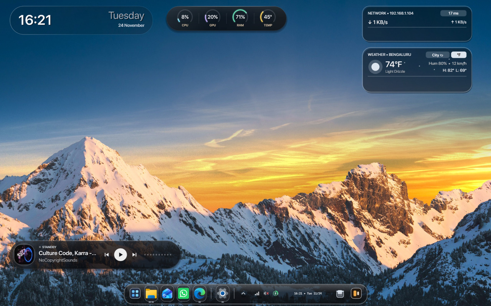
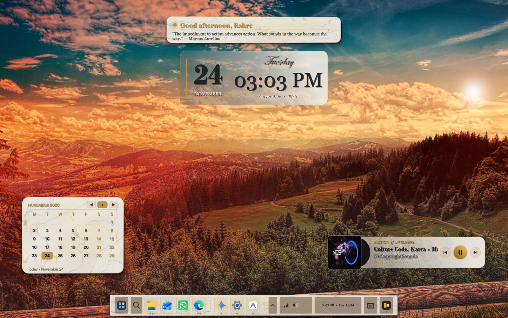
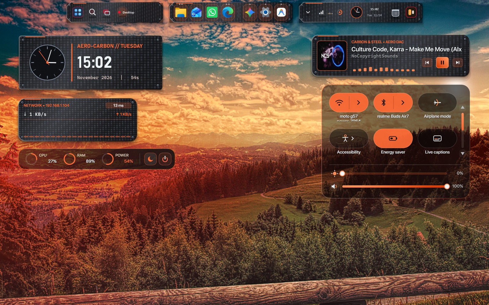
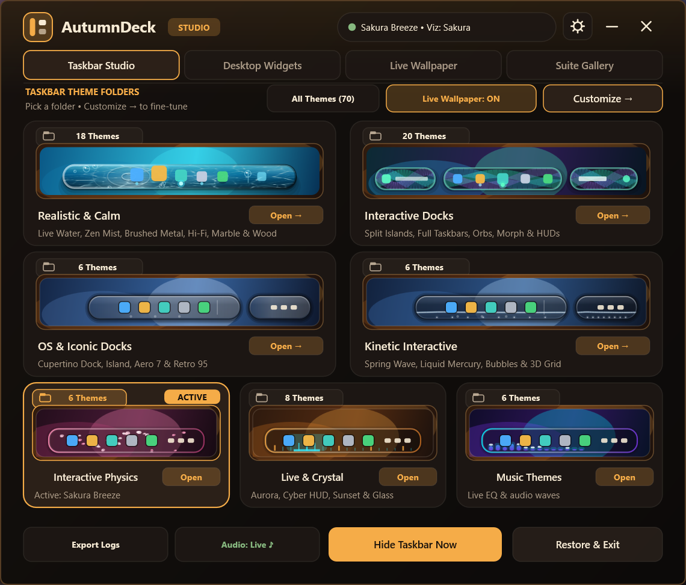
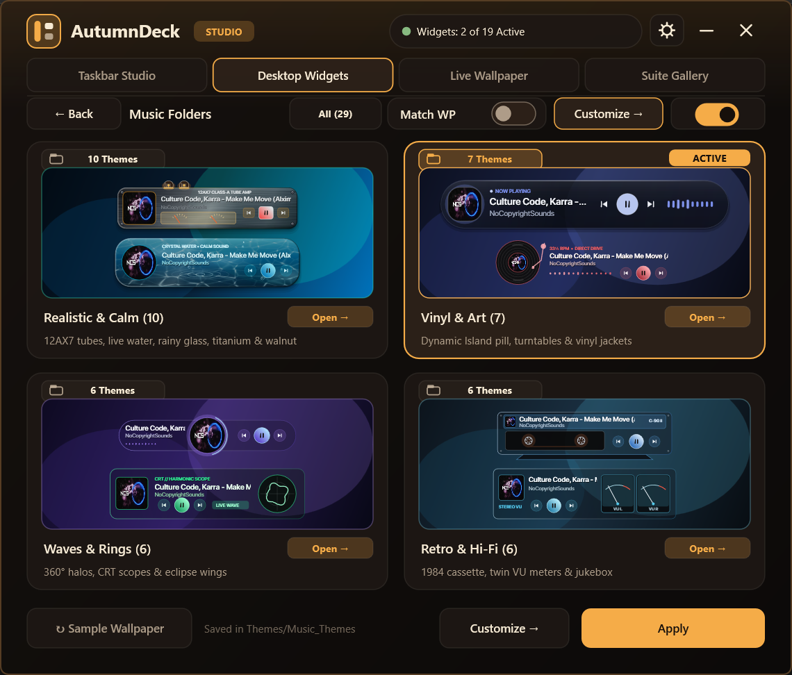

# AutumnDeck

  
  &nbsp;
  

  <strong>Native Windows 11 Taskbar Styler, Interactive PBR Docks, Modular Desktop Widgets &amp; Live Wallpaper Suite</strong> 
  Built from scratch in <strong>Rust + Win32 + Direct2D + DirectComposition</strong> for near-zero memory footprint (&lt;50 MB RAM) and zero Chromium/Electron bloat.

  

---

## Showcase

<table>
  <tr>
    <td align="center" width="50%">
       
      <b>Marble Sanctuary</b> — Editorial clock, calendar, quote bar &amp; LP sleeve player
    </td>
    <td align="center" width="50%">
       
      <b>Aero-Carbon</b> — Carbon fiber split dock, vitals HUD &amp; Quick Settings
    </td>
  </tr>
  <tr>
    <td align="center" width="50%">
       
      <b>Taskbar Studio</b> — 70 curated taskbar &amp; dock themes across 7 styles
    </td>
    <td align="center" width="50%">
       
      <b>Music Players</b> — 29 reactive themes (12AX7 tubes, turntables, VU meters)
    </td>
  </tr>
</table>

---

## Features
- **Native Windows 11 Taskbar Styler:** Blur, Acrylic, Clear, Split Pill, and Katana Smoked Glass via lightweight XAML TAP composition.
- **Interactive & PBR Realistic Docks:** Smooth macOS-style magnification, live app previews, tray overflow, and 12 baked PBR surface materials (Carbon, Titanium, Walnut, Silk, Marble, and more).
- **Modular Desktop Widgets + Pen & Canvas 2.0:**
  - Clock & Script Date
  - Dynamic Island Capsule Music Player & Turntable with Live Visualizer
  - Celestial Sun-Dial Weather Dashboard (7-day Open-Meteo + auto IP geolocation)
  - Telemetry Ring-Pill Vitals HUD
  - Control Center, Notes & To-Do, Pomodoro, Quick Apps
  - Full per-element Move, Scale, Rotate, Font Picker, and Live Chameleon wallpaper color matching
- **Live Wallpaper Engine:** Hardware-accelerated DXGI Flip-Model SwapChain for `.mp4`/`.mkv`/`.webm` video loops and high-res `.png`/`.jpg`/`.webp` static wallpapers with instant fullscreen/game auto-pause.
- **30 Curated Suites & Portable Backup:** Instant Suite Gallery switching plus 1-click **Export / Import Setup (`.autumn`)** under App Settings (`⚙`).

---

## Requirements
- **Windows 11 64-bit** (22H2 / 23H2 / 24H2 / 26H2) recommended for native XAML taskbar styling
- **Windows 10 64-bit** (2004+) supported for Virtual Docks, Desktop Widgets, and Live Wallpapers

---

## Download & Installation

### Option 1: Microsoft Store (Recommended — Digitally Signed & Auto-Updating)

- **Official Microsoft Signed Package:** 100% clean install with zero Windows SmartScreen or Smart App Control warnings.
- **Instant 1-Click Install:** Or open `ms-windows-store://pdp/?productid=9P6NTH74WSMD` directly.

---

### Option 2: Standalone Releases (Portable ZIP & Setup Installer — Unsigned)
> [!NOTE]
> Standalone binaries distributed on GitHub are compiled directly from open-source code and are **not digitally signed** (commercial certificates cost \$300+/year). For the **official digitally signed edition with zero security warnings**, please use **[Option 1: Microsoft Store](https://apps.microsoft.com/detail/9P6NTH74WSMD)**.

1. Download from **Releases**:
   - **Portable Edition:** `AutumnDeck-2.0.6-Portable.zip` (extract anywhere and run `AutumnDeck.exe`).
   - **Installer:** `AutumnDeck-Setup-2.0.6.exe`
2. Right-click the **AutumnDeck** tray icon (or press `Ctrl + Alt + T`) to open **AutumnDeck Studio**.
3. Open **`⚙` App Settings** in the top-right header to toggle **Launch at Windows Login** or **Export / Import Setup**.

#### ⚠️ Windows SmartScreen Note
Because standalone GitHub `.exe`/`.zip` builds are unsigned:
1. If Windows SmartScreen appears, click **"More info" ➔ "Run anyway"**.
2. For `.zip` downloads, right-click the `.zip` ➔ **Properties** ➔ check **Unblock** ➔ click **Apply** before extracting.
3. Prefer zero prompts? Install the **Microsoft Store** edition above (digitally signed by Microsoft).

---

## Community & Sponsorship
If you love AutumnDeck and want to support ongoing development, new presets, and features:

  
  
  

- **Ko-fi (One-time tips):** [ko-fi.com/autumndeck](https://ko-fi.com/autumndeck) — Tip any custom amount once via PayPal or Card.
- **Patreon:** [patreon.com/c/AutumnDeck](https://www.patreon.com/c/AutumnDeck)
- **GitHub Sponsors:** [github.com/sponsors/Shreyas123g](https://github.com/sponsors/Shreyas123g)

---

## Privacy Policy
This program will not transfer any information to other networked systems unless specifically requested by the user or the person installing or operating it (e.g., retrieving weather data from Open-Meteo only when the Weather widget is enabled). AutumnDeck does not collect, track, or share any personal data, analytics, or telemetry. Full details: [PRIVACY.md](PRIVACY.md).

